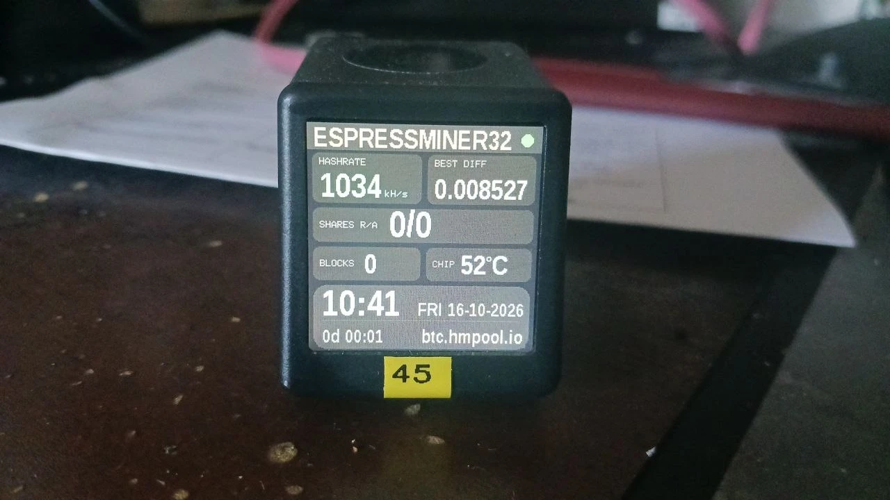
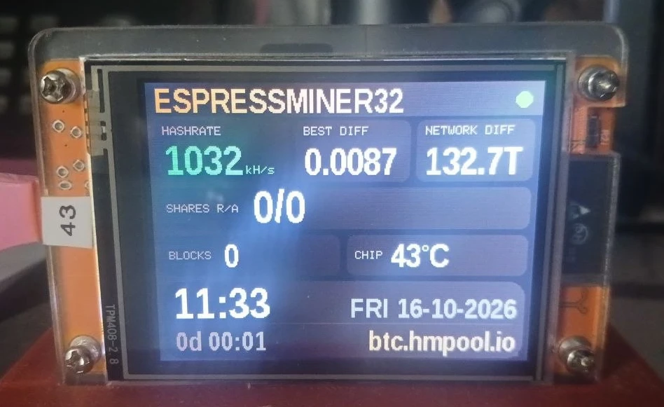

# ☕ ESPressMiner32

🇬🇧 [English](README.md) · 🇩🇪 **Deutsch**

Ein Bitcoin-Stratum-Miner (V1) für den **klassischen ESP32**. Er nutzt den **SHA-256-Hardwarebeschleuniger**
per direktem Registerzugriff mit einer Pipeline: Die Daten für den nächsten Block werden geschrieben,
während die Engine noch rechnet.

Gemessen auf ESP32-D0WD-V3 @ 240 MHz: **~1034 kH/s (über 1 MH/s)** (Hardware ~1000 kH/s mit 240 Takten pro Double-SHA256
+ Software-Miner auf dem zweiten Kern ~35 kH/s), Version **1.3.1 (getestet)**.
Nachtlauf 9,6 h: Ø **1033,7 kH/s**, nie unter 1032, **0 Neustarts, 851/851 Shares angenommen, 2 Rechenfehler**.
**Beim Pool nachgemessen** statt nur angezeigt: 1045 ±39 kH/s angekommen über 8 volle Stunden dieser Nacht.

🔗 **Projektseite:** https://github.com/brenner23/ESPressMiner32

> ⚠️ **Hobbyprojekt.** Mit einem ESP32 findet man realistisch keinen Bitcoin-Block. Es geht ums Lernen,
> Basteln und Ausreizen der Hardware. Ideal für Solo-Pools, Lotterie-Mining oder den eigenen Test-Pool.

## Versionen

| Version | kH/s | Takte/Hash | Was ist neu |
|---|---|---|---|
| **1.3.1** (aktuell, getestet) | **~1034** | 240 + SW | = pre4 nach 9,6 h Nachtlauf; Dashboard zeigt nur Fehler der Schleife (`SHOW_WAVE_ERRORS`) |
| 1.3.0.011-pre4 (Vorabversion) | ~1035 | 240 + SW | Interrupts auf Core 1 je Charge gesperrt, schneller Software-Scan (35 kH/s), Hash-Schleifen an fester Stelle im Speicher, Fehler aus WLAN-Wellen getrennt angezeigt |
| 1.3.0.009 | ~1024 | 240 + SW | Schleife „O“ (240 Takte), WLAN-Wächter, Schutzfenster gegen periodische WLAN-Störungen, Überhitzungsschutz, Oberfläche auf Englisch |
| 1.2.1 | ~990 | 247 + SW | Software-Miner auf Core 0 wieder an: kostet die Hardware nur noch ~3 kH/s |
| 1.2.0 | ~963 | 247 | Neue Hash-Schleife „v2“ aus [NerdMiner Modded](https://github.com/HenrysCat/NerdMiner-Modded) (MIT), Known-Answer-Test beim Start, automatische Rückfallstufen |
| 1.1.0 | ~960 | 249 | Taktgenaue Warteschleifen, Kalibrierung prüft die echte Mining-Schleife (behebt einen Fehler aus 1.0.0), robustere Kalibrierung |
| 1.0.0 | ~902 | 265 | Erste Version |

Jede Version ist ein fester Git-Tag. Ältere Versionen: oben im Auswahlfeld **„main ▾“ → Tags** wählen
(oder `git checkout v1.0.0`) und wie gewohnt flashen. Die Einstellungen (WLAN, Pools) bleiben beim Wechsel erhalten.
Es gibt bewusst keine fertigen Firmware-Dateien: Geflasht wird, was man im Quellcode nachlesen kann.

---

## Funktionen

- **~1034 kH/s (über 1 MH/s)** auf einem klassischen ESP32 (Hardware-SHA-Pipeline auf Core 1 + Software-Miner auf Core 0)
- **Selbsttest** beim Start (Genesis-Block, 2000 Zufalls-Header, 5000 Nonces). Schlägt er fehl, wird nicht gemint.
- **Jeder Treffer wird in Software nachgerechnet**, bevor ein Share zum Pool geht
- **Web-Dashboard** unter `http://espressminer.local/` mit Hashrate-Verlauf, JSON unter `/api/stats`
- **Primary- und Secondary-Pool** mit automatischem Wechsel
- **Einrichtung ohne Programmieren:** WLAN-Portal, Setup-Programm mit Oberfläche oder Kommandozeile
- **Blaue LED (GPIO2)** leuchtet beim Minen und blinkt bei jedem Share

## Display-Version (Branch `display`, Teststand)

Gleicher Miner, gleiche Hash-Schleifen (**gleiche ~1034 kH/s, keine zusätzlichen Schleifenfehler**), dazu ein
Dashboard auf zwei günstigen Boards:

| Board | Display | PlatformIO-Env |
|---|---|---|
| **NM-TV 154** | ST7789 240×240 | `nmtv154` |
| **CYD** (ESP32-2432S028-Typ mit ST7789) | ST7789 320×240, quer oder hochkant, Lichtsensor (GPIO 34) | `cyd` |

<p>


</p>

- Flaches Design: Nur Felder, deren Wert sich geändert hat, werden gelöscht und neu geschrieben (alle 5 s,
  Zeichen-Task auf Core 0, ~29 ms je Durchlauf) – die Hash-Schleife auf Core 1 merkt davon nichts. Die
  `hw_*`-Schleifen liegen an genau denselben Adressen wie in v1.3.1 (nach jedem Bauen geprüft).
- Startbild mit Fortschrittsbalken und Status (Selbsttest, Benchmark, WLAN, Pool), die IP steht 3 s lang da.
- Hashrate ohne Nachkommastelle (abgeschnitten, nie aufgerundet), Shares, Best Difficulty, Blöcke,
  Chiptemperatur, Uhr + Datum (NTP), Laufzeit und Pool-Name.
- **Netz-Difficulty** (ab d5): CYD quer als dritte Blase neben Hashrate und Best Difficulty, hochkant in
  eigener Zeile, NM-TV klein als „NET 75“ in der Labelzeile.
- Difficulty-Werte mit höchstens 4 Nachkommastellen, abgeschnitten (0.0237, 5.432, 523.7), ab 1000 mit K/M/G/T (132.7T).
- Weboberfläche → Einstellungen → **Display** (ganz unten): 3 Farbdesigns, Helligkeit mit Live-Vorschau;
  NM-TV: Tag-/Nachthelligkeit mit Nachtzeiten; CYD: Drehung und „Auto light“ über den Lichtsensor.
- Startbild immer mit 100 % Helligkeit, danach der eingestellte Wert.
- **Chiptemperatur** (ab d7): alle 5 s gemessen, Median der letzten 7 Werte. Hinweis: Der interne Sensor des ESP32
  weicht von Chip zu Chip um bis zu ~30 °C ab (drei gleiche Boards zeigten beim Kaltstart 34 / 49 / 64 °C), darum greift
  der Überhitzungsschutz erst ab 105 °C (Software-Miner pausiert) bzw. 115 °C (Mining gestoppt).
- Schrift **Archivo Narrow Bold** (SIL Open Font License) **liegt bei** – einfach bauen und flashen, siehe [include/fonts/README.md](include/fonts/README.md).

## Projektstruktur

```
ESPressMiner32/
├── platformio.ini            Build-Konfiguration (240 MHz, -O2)
├── include/
│   ├── credentials.h         Startwerte (leer, optional)
│   ├── config.h              Difficulty, Cores, LED, Nonce-Bereiche
│   ├── sha256_hw.h           Hardware-SHA-Pipeline
│   ├── sha256_sw.h           Software-SHA-256 (Coinbase, Merkle, Prüfung)
│   ├── stratum_client.h      Stratum-V1-Client
│   ├── mining_job.h          Job-/Share-Austausch zwischen den Tasks
│   └── ...
├── src/                      Implementierungen zu den Headern + main.cpp
├── src/hw_scan_asm.S         Hash-Schleife in Assembler (Versuch, abgeschaltet: HW_USE_ASM)
├── tools/                    Setup per USB: espressminer_setup_gui.py (Oberfläche), espressminer_setup.py
├── test/hw_probe/            Messprogramm für den SHA-Beschleuniger (Entwicklung)
└── test/pipe_probe/          Messprogramm für die Pipeline ab 1.1.0 (Entwicklung)
```

## Bauen & Flashen (VS Code + PlatformIO)

1. Ordner in VS Code öffnen (die PlatformIO-Erweiterung wird vorgeschlagen).
2. ESP32 per USB anschließen. PlatformIO findet den COM-Port automatisch.
3. Unten in der Statusleiste **→ Upload** (bzw. `pio run -t upload`).
4. **Serial Monitor** (115200 Baud) zeigt Selbsttest, Benchmark und alle 5 s die Hashrate.

Zugangsdaten müssen nicht in den Code: `include/credentials.h` ist absichtlich leer, eingerichtet wird nach dem Flashen.

## Ersteinrichtung (nach dem Flashen)

Solange keine Einstellungen gespeichert sind, startet der Miner **nicht** zum Minen, sondern wartet auf die Einrichtung.

**1. WLAN-Portal (Handy/Laptop)**
Mit dem WLAN `ESPressMiner32-XXXX` (Passwort `espressminer`) verbinden. Die Einrichtungsseite öffnet sich
automatisch, sonst `http://192.168.4.1/` aufrufen. Ausfüllen, „Speichern & Neustart“.
Das Portal startet auch, wenn das gespeicherte WLAN 20 s lang nicht erreichbar ist.

**2. Setup-Programm mit Oberfläche** (`pip install pyserial`)
```
python tools/espressminer_setup_gui.py
```
COM-Port wählen, Felder ausfüllen (oder „JSON laden …“), „Speichern & Neustart“.
Vorlage für mehrere Miner: `tools/credentials.example.json`.

**3. Kommandozeile über USB**
```
python tools/espressminer_setup.py                 # interaktiv, COM-Port wird gesucht
python tools/espressminer_setup.py --port COM3 --get
python tools/espressminer_setup.py --ssid MeinWLAN --password geheim ^
       --pool stratum+tcp://pool.example.com:3333 --wallet ADRESSE.Worker -y
python tools/espressminer_setup.py --reset         # Einstellungen löschen -> Portal
```

**4. Serielle Konsole direkt** (115200 Baud), eine JSON-Zeile pro Befehl, Antworten beginnen mit `@CM `:
```
{"cmd":"info"}   {"cmd":"get"}   {"cmd":"reset"}   {"cmd":"restart"}
{"cmd":"set","hostname":"espressminer","wifiSsid":"...","wifiPass":"...",
 "pools":[{"url":"stratum+tcp://host:3333","user":"ADRESSE.Worker","pass":"x"},{"url":""}]}
```

**Zurücksetzen ohne PC:** BOOT-Taste 5 s gedrückt halten → Einstellungen gelöscht, Neustart ins Portal.

## Ablauf

| Core | Aufgabe |
|------|---------|
| 1 | Hardware-SHA-Miner (exklusiv) |
| 0 | WLAN, Stratum-Client, Web-Dashboard, Statistik, Software-Miner (ab 1.2.1) |

- **Einstellungen** (Zahnrad im Dashboard): Hostname, WLAN, Primary- und Secondary-Pool, gespeichert im Flash (NVS).
  Nach 3 Fehlversuchen wechselt der Miner zum anderen Pool, vom Secondary aus wird alle 10 Minuten der Primary erneut versucht.
- Das Dashboard läuft auf Core 0. Häufiges Neuladen kostet kurzzeitig ein paar kH/s (gemessen ~4).

## Wie die Hashrate zustande kommt

| Schritt | kH/s |
|---|---|
| Einfacher Hardware-Weg (BUSY abfragen) | ~360 |
| Pipeline: nächsten Block schreiben, während die Engine rechnet | ~557 |
| Textregister gepuffert schreiben, ohne `memw` (Idee aus SparkMiner) | ~650 |
| Basisadresse im Register statt `l32r` pro Zugriff | ~700 |
| Feste Wartezeiten statt BUSY (das Flag hängt ~34 Takte nach) | ~800 |
| Kein `memw` nach LOAD | ~833 |
| Wartezeit je Phase einzeln kalibriert | ~842 |
| Software-Pipeline: nächsten Block 1 vor der Kandidatenprüfung starten | ~902 (v1.0.0) |
| Taktgenaue Zählschleife (`loopnez`) statt Abfrage der Taktuhr, LOAD-Zeiten getrennt | ~960 (v1.1.0) |
| Hash-Schleife „v2“ aus NerdMiner Modded: Wartezeiten gezählt, alles außer T[0..7] in Rechenzeit der Engine | ~963 (v1.2.0) |
| Software-Miner auf Core 0 dazu (SHA-Writes ≥ 3 Takte auseinander, siehe unten) | ~990 (v1.2.1) |
| Header-Wörter in Registern, Wartezeiten einzeln an die Grenze gemessen (Schleife „O“, 240 Takte) | ~1024 (v1.3.0.009) |
| Interrupts auf Core 1 während jeder Charge gesperrt | ~1026 (pre1) |
| Schneller Software-Scan (vorberechnete Runden, früher Abbruch), Hash-Schleifen an fester Stelle | **~1035** (pre3/pre4) |

### Ab 1.3.0.011: Hash-Schleifen an fester Stelle im Speicher

Die Hash-Schleifen laufen so knapp am Limit der SHA-Engine, dass sogar ihre **Lage im IRAM** zählt: Als der schnelle
Software-Scan (17 KB Code) dazukam, rutschten sie im Speicher nach hinten, und es gab ~10 % Rechenfehler – auch mit
abgeschaltetem schnellen Pfad (Gegenprobe). `HW_LOOP_PIN` in `src/hw_scan_v2.S` legt den Block der Schleifen deshalb
immer auf denselben Versatz innerhalb von 4 KB wie in der gemessenen Version. Wer Code hinzufügt, kann mit
`xtensa-esp32-elf-nm -n .pio/build/esp32dev/firmware.elf | grep hw_` prüfen, ob die Adressen (modulo 0x1000) gleich bleiben.

### Ab 1.2.0: Hash-Schleife „v2“ (Quelle: NerdMiner Modded)

`src/hw_scan_v2.S` ist eine Portierung der Schleife `pipelined_hw_sha_classic_v2.S` aus
[NerdMiner Modded](https://github.com/HenrysCat/NerdMiner-Modded) von HenrysCat
([Projektseite](https://henryscat.github.io/NerdMiner-Modded/), MIT-Lizenz, Lizenztext in
[THIRD_PARTY_LICENSES.md](THIRD_PARTY_LICENSES.md)). Die dort gemessenen Wartezeiten sind unverändert übernommen.
Die wichtigste Erkenntnis aus diesem Projekt: **Writes auf die SHA-Register müssen mindestens 3 Takte auseinander
liegen.** Sonst gehen sie verloren, sobald der andere Kern gleichzeitig auf den Bus zugreift. Genau deshalb hat der
Software-Miner in 1.1.0 die Hardware um ~95 kH/s ausgebremst. Mit v2 sind es nur noch ~3 kH/s.

Beim Start prüft ein **Known-Answer-Test** (262.144 Nonces, genau 6 bekannte Treffer, unabhängig in Python
nachgerechnet) die schnelle Stufe. Fällt sie durch, kommen +2 Takte Reserve, dann breite Reserve, zuletzt die
kalibrierte Schleife aus 1.1.0. Chips vor Revision 3 bekommen immer die klassische Schleife (DPORT-Fehler im Silizium).
Im Betrieb wird mitgezählt: Bestätigt die Software von 256 Hardware-Treffern 8 oder mehr nicht, wechselt der
Miner von selbst auf die nächste, vorsichtigere Stufe.

Bis 1.1.0 (und als letzte Rückfallstufe) werden die Wartezeiten bei jedem Start **kalibriert**: Der ESP32 sucht per Binärsuche die kleinste fehlerfreie
Wartezeit je Phase (auf 1 Takt genau) und schlägt `HW_CAL_MARGIN_*` Takte Reserve drauf. Geprüft wird dabei
genau die Schleife, die auch mint. Ein Prüfschritt gilt erst nach zweimaligem Durchfallen als zu knapp, und die
Kalibrierung hat bis zu drei Anläufe. Erst danach greifen langsame Notwerte. Im laufenden Betrieb werden die
Wartezeiten nicht mehr verändert.

Eine Hash-Schleife in Assembler liegt bei (`src/hw_scan_asm.S`), ist aber langsamer (255 Takte): Ab hier begrenzt
der Bus zum SHA-Baustein (rund 40 Zugriffe pro Hash), nicht mehr der Code.

Der klassische ESP32 kann keinen SHA-Zwischenstand (Midstate) in die Engine zurückladen. Pro Nonce sind deshalb
immer drei Hardware-Blöcke nötig.

Messwerkzeuge: `pio run -e hw_probe -t upload` (Registerzugriffe, Engine-Zeiten) und
`pio run -e pipe_probe -t upload` (Wartezeiten und Varianten der Pipeline ab 1.1.0).

## Rechenfehler, ehrlich gesagt

### WLAN-Wellen und Schutzfenster (ab 1.3.0.008)

In Langzeittests kamen die restlichen Rechenfehler fast nur als **Schub von 5–8 Fehlern, pünktlich alle ~600 s**.
Die Ursache liegt nicht im Miner, sondern in der **WLAN-Verbindung**: Der Takt hängt an der Anmeldung des ESP am WLAN
und springt bei einer Neuanmeldung mit. Sehr wahrscheinlich ist es eine periodische Aktion des Access Points, z. B. der
Schlüsselwechsel oder die Mesh-Funktion einer **Fritzbox**. IP-Verkehr (Ping-Flut, UDP-Flut) stört dagegen nicht.
Je nach Router kann der Takt anders sein oder ganz fehlen.

Das **Schutzfenster** lernt diesen Takt aus den Schüben selbst (1–30 min) und rechnet 6 s vor bis 6 s nach dem erwarteten
Zeitpunkt mit einer etwas vorsichtigeren Schleife (Kosten ~1 kH/s). Jedes 6. Fenster bleibt als Stichprobe ungeschützt,
damit der Miner merkt, ob die Welle noch da ist. Nach einem Neustart trifft die erste Welle ungeschützt, weil der Takt
erst gelernt wird.

**Schalter `SHOW_WAVE_ERRORS`** (ganz oben in `include/config.h`, ab 1.3.1):
- `0` (Standard): Dashboard und Konsole zeigen nur die Fehler der Hash-Schleife, z. B. `2 discarded (calculation errors)`.
- `1`: zusätzlich die Fehler aus WLAN-Wellen, z. B. `2 discarded (+73 from 10 Wi-Fi waves)` – zum Ausmessen des eigenen Netzes.

Gelöscht wird in keinem Fall etwas: `/api/stats` liefert immer `hwErrors` (gesamt), `waveErrors` und `loopErrors`.
Die Aufteilung ist eine Messhilfe; im Zweifel gilt `hwErrors`.

### Display gegen Pool

Ein Miner kann auf dem Display viel anzeigen. Was zählt, ist, was beim Pool ankommt (angenommene Shares × Difficulty × 2³² / Zeit).
Gegenprobe auf einem eigenen Stratum-Pool, 24 volle Stunden, Pool-Difficulty 0,01 (±2 %):

| Miner | Anzeige | beim Pool angekommen |
|---|---|---|
| ESPressMiner32 1.3.0.009 | 1024 | **1062 ±23** |
| 5 andere ESP32-Miner (geschlossene Firmware), Schnitt | ~1027 | ~1000 |


**So liest man diesen Screenshot** (getesteter Stand 1.3.0.011-pre4 = 1.3.1, Live-Werte nach 9 h 44 min, Dashboard von 1.3.1):
- **2 discarded** = echte Rechenfehler der Hash-Schleife in knapp 10 Stunden (~1 von 270.000 Treffern).
- **Zusätzlich wurden in diesem Test 73 Fehler aus 10 WLAN-Wellen abgefangen** (FRITZ!Box im Testnetz, siehe oben).
  Mit `SHOW_WAVE_ERRORS 0` werden sie nicht angezeigt, aber weiter in `/api/stats` gezählt (`waveErrors`, `hwErrors`).
  9 der 10 Wellen sind die stündliche Stichprobe; alle 48 geschützten Fenster hatten 0 Fehler.
- **Die kleine Delle im Hashrate-Verlauf ist ein Schutzfenster, kein Fehler:** Um jede erwartete WLAN-Welle (~alle 600 s)
  mint der Miner ~12 s lang mit der etwas langsameren sicheren Schleife. Nichts startet neu, nichts geht verloren – der
  Miner ist nicht „alle 10 Minuten kaputt“. In Netzen ohne solche Wellen springt das Schutzfenster nie an.
- Falsche Hashes erreichen nie den Pool: Jeder Treffer wird in Software nachgerechnet (0 abgelehnt).
- **Komplettes Nachtprotokoll** (eine Zeile pro Minute, ~9,8 h, ohne private Daten): [docs/nachtlauf_v1.3.1.log](docs/nachtlauf_v1.3.1.log) · [CSV](docs/nachtlauf_v1.3.1.csv)

### Ab 1.2.0 (v2-Schleife)

Brenntest mit Pool-Verbindung und WLAN: 26,7 Minuten, Ø **989,6 kH/s**, 1,59 Mrd. Hashes:
**0 Rechenfehler**, **42 von 42 Shares akzeptiert** (erwartet ~36 bei Pool-Diff 0,01). Als Echtheits-Check zählt
`/api/stats` alle 16-Bit-Treffer (`candidates`): Es müssen ~Hashes/65.536 sein, gemessen 99,6 % davon
(23.982 von ~24.070, innerhalb der statistischen Schwankung). Die Hashrate ist also wirklich gerechnet, nicht nur gezählt.


### Bis 1.1.0

Um diese Geschwindigkeit zu erreichen, wird der SHA-Baustein **nicht nach Datenblatt** betrieben: Die Daten
werden geschrieben, während er noch rechnet, und statt auf sein BUSY-Signal zu warten, gelten fest gemessene
Wartezeiten. Dadurch rechnet er gelegentlich falsch.

- **Gemessen (v1.1.0, 17 Mio. geprüfte Hashes, WLAN aktiv): etwa 1 falscher Hash je 17.000, also ~0,006 %.**
  Die Quote blieb über die Zeit stabil. Mehr Reserve bei den Wartezeiten senkt sie nicht. Ursache ist vermutlich
  der WLAN-Verkehr auf dem gemeinsamen Bus.
- **Ein falscher Hash geht nie an den Pool.** Jeder Treffer wird vorher in Software nachgerechnet.
- Das Dashboard zeigt unter „verworfen (Rechenfehler)“ nur die falschen Hashes, die zufällig wie ein Treffer
  aussehen (etwa einer von 65.536), bei ~960 kH/s im Schnitt ungefähr einer alle 20 Minuten.
- Auswirkung auf den Ertrag: ~0,006 %, also nicht messbar.

## Entwicklung

Entwickelt mit Unterstützung von [Claude](https://claude.ai) (Anthropic) als KI-Programmierassistent. Entscheidungen, Tests auf echter Hardware und Messungen: brenner23.

## Lizenz

[MIT](LICENSE) © 2026 brenner23. Nutzung auf eigene Verantwortung.
Danksagungen und Bibliotheken: [THIRD_PARTY_LICENSES.md](THIRD_PARTY_LICENSES.md).
