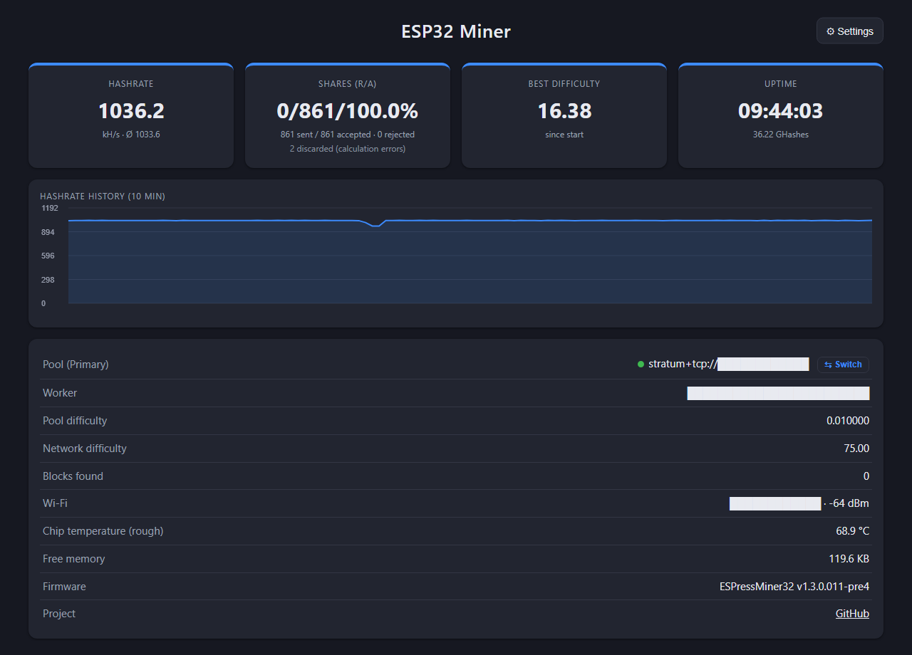
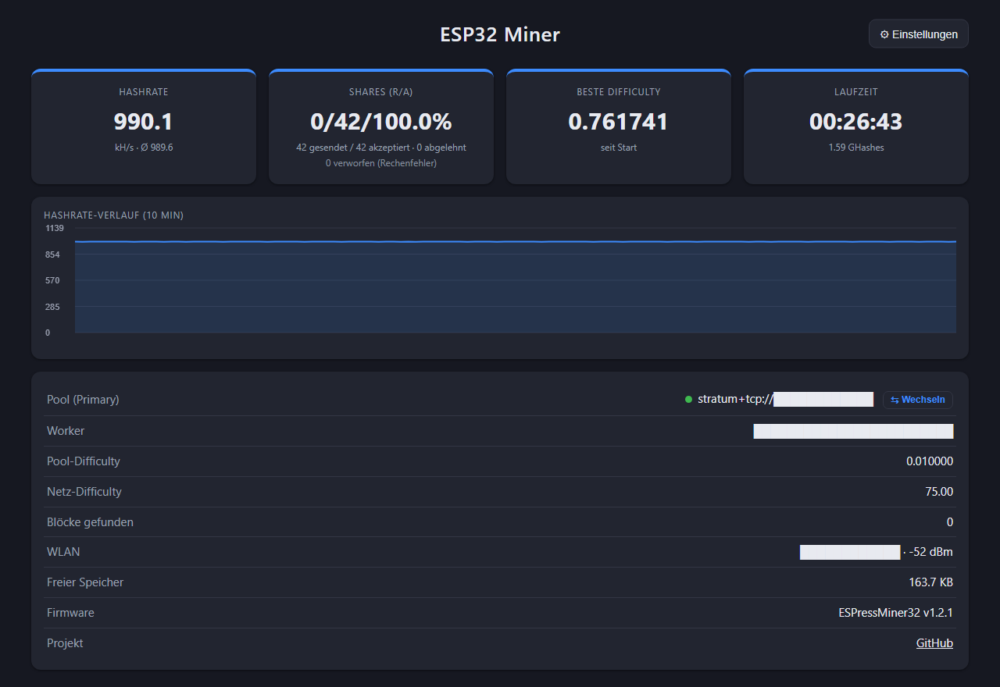

# ☕ ESPressMiner32

🇬🇧 **English** · 🇩🇪 [Deutsch](README.de.md)

A Bitcoin Stratum (V1) miner for the **classic ESP32**. It drives the **SHA-256 hardware accelerator**
through direct register access with a pipeline: the data for the next block is written while the engine
is still computing.

Measured on ESP32-D0WD-V3 @ 240 MHz: **~1034 kH/s (over 1 MH/s)** (hardware ~1000 kH/s at 240 cycles per double SHA-256
+ software miner on the second core ~35 kH/s), version **1.3.1 (tested)**.
Night run 9.6 h: average **1033.7 kH/s**, never below 1032, **0 restarts, 851/851 shares accepted, 2 calculation errors**.
**Verified at the pool**, not just displayed: 1045 ±39 kH/s arrived over 8 full hours of that night.

🔗 **Project page:** https://github.com/brenner23/ESPressMiner32

> ⚠️ **Hobby project.** Realistically an ESP32 will never find a Bitcoin block. This is about learning,
> tinkering and pushing the hardware to its limit. Great for solo pools, lottery mining or your own test pool.
>
> Web UI, API and serial output are in English (since 1.3.0.007); the setup tools are still in German.

## Versions

| Version | kH/s | Cycles/hash | What's new |
|---|---|---|---|
| **1.3.1** (current, tested) | **~1034** | 240 + SW | = pre4 after a 9.6 h night run; dashboard shows only loop errors (`SHOW_WAVE_ERRORS`) |
| 1.3.0.011-pre4 (pre-release) | ~1035 | 240 + SW | Interrupts on core 1 masked per batch, fast software scan (35 kH/s), hash loops pinned in memory, Wi-Fi wave errors shown separately |
| 1.3.0.009 | ~1024 | 240 + SW | Loop "O" (240 cycles), Wi-Fi watchdog, guard window against periodic Wi-Fi disturbance, overheat protection, English UI |
| 1.2.1 | ~990 | 247 + SW | Software miner on core 0 enabled again: now costs the hardware only ~3 kH/s |
| 1.2.0 | ~963 | 247 | New "v2" hash loop from [NerdMiner Modded](https://github.com/HenrysCat/NerdMiner-Modded) (MIT), known-answer test at boot, automatic fallback stages |
| 1.1.0 | ~960 | 249 | Cycle-exact wait loops, calibration checks the real mining loop (fixes a bug in 1.0.0), more robust calibration |
| 1.0.0 | ~902 | 265 | First release |

Every version is a fixed Git tag. For an older version pick **"main ▾" → Tags** at the top (or `git checkout v1.0.0`)
and flash as usual. Settings (Wi-Fi, pools) survive the switch.
There are intentionally no prebuilt firmware files: you flash what you can read in the source.

---

## Features

- **~1034 kH/s (over 1 MH/s)** on a classic ESP32 (hardware SHA pipeline on core 1 + software miner on core 0)
- **Self-test** at boot (genesis block, 2000 random headers, 5000 nonces). If it fails, the miner does not mine.
- **Every hit is re-checked in software** before a share is sent to the pool
- **Web dashboard** at `http://espressminer.local/` with hashrate history, JSON at `/api/stats`
- **Primary and secondary pool** with automatic failover
- **Setup without coding:** Wi-Fi portal, GUI setup tool or command line
- **Blue LED (GPIO2)** is on while mining and blinks on every share

## Project layout

```
ESPressMiner32/
├── platformio.ini            Build configuration (240 MHz, -O2)
├── include/
│   ├── credentials.h         Default values (empty, optional)
│   ├── config.h              Difficulty, cores, LED, nonce ranges
│   ├── sha256_hw.h           Hardware SHA pipeline
│   ├── sha256_sw.h           Software SHA-256 (coinbase, merkle, verification)
│   ├── stratum_client.h      Stratum V1 client
│   ├── mining_job.h          Job/share exchange between tasks
│   └── ...
├── src/                      Implementations + main.cpp
├── src/hw_scan_asm.S         Hash loop in assembly (experiment, disabled: HW_USE_ASM)
├── tools/                    USB setup: espressminer_setup_gui.py (GUI), espressminer_setup.py
├── test/hw_probe/            Measurement firmware for the SHA accelerator (development)
└── test/pipe_probe/          Measurement firmware for the pipeline since 1.1.0 (development)
```

## Build & flash (VS Code + PlatformIO)

1. Open the folder in VS Code (the PlatformIO extension will be suggested).
2. Connect the ESP32 via USB. PlatformIO finds the COM port automatically.
3. Click **→ Upload** in the status bar (or `pio run -t upload`).
4. The **serial monitor** (115200 baud) shows the self-test, the benchmark and the hashrate every 5 s.

No credentials in the code: `include/credentials.h` is intentionally empty, everything is configured after flashing.

## First-time setup (after flashing)

As long as no settings are stored, the miner does **not** start mining but waits to be configured.

**1. Wi-Fi portal (phone/laptop)**
Connect to the Wi-Fi `ESPressMiner32-XXXX` (password `espressminer`). The setup page opens automatically,
otherwise go to `http://192.168.4.1/`. Fill in the form, then "Speichern & Neustart" (save & restart).
The portal also starts if the stored Wi-Fi cannot be reached for 20 s.

**2. GUI setup tool** (`pip install pyserial`)
```
python tools/espressminer_setup_gui.py
```
Pick the COM port, fill in the fields (or load a JSON file), save & restart.
Template for multiple miners: `tools/credentials.example.json`.

**3. Command line over USB**
```
python tools/espressminer_setup.py                 # interactive, COM port is detected
python tools/espressminer_setup.py --port COM3 --get
python tools/espressminer_setup.py --ssid MyWiFi --password secret ^
       --pool stratum+tcp://pool.example.com:3333 --wallet ADDRESS.worker -y
python tools/espressminer_setup.py --reset         # erase settings -> portal
```

**4. Raw serial console** (115200 baud), one JSON line per command, replies start with `@CM `:
```
{"cmd":"info"}   {"cmd":"get"}   {"cmd":"reset"}   {"cmd":"restart"}
{"cmd":"set","hostname":"espressminer","wifiSsid":"...","wifiPass":"...",
 "pools":[{"url":"stratum+tcp://host:3333","user":"ADDRESS.worker","pass":"x"},{"url":""}]}
```

**Reset without a PC:** hold the BOOT button for 5 s → settings erased, restart into the portal.

## How it works

| Core | Task |
|------|------|
| 1 | Hardware SHA miner (exclusive) |
| 0 | Wi-Fi, Stratum client, web dashboard, statistics, software miner (since 1.2.1) |

- **Settings** (gear icon in the dashboard): hostname, Wi-Fi, primary and secondary pool, stored in flash (NVS).
  After 3 failed attempts the miner switches to the other pool; from the secondary it retries the primary every 10 minutes.
- The dashboard runs on core 0. Frequent reloading briefly costs a few kH/s (measured ~4).

## Where the hashrate comes from

| Step | kH/s |
|---|---|
| Plain hardware path (polling BUSY) | ~360 |
| Pipeline: write the next block while the engine computes | ~557 |
| Buffered text register writes without `memw` (idea from SparkMiner) | ~650 |
| Base address kept in a register instead of `l32r` per access | ~700 |
| Fixed wait times instead of BUSY (the flag lags ~34 cycles) | ~800 |
| No `memw` after LOAD | ~833 |
| Wait time calibrated per phase | ~842 |
| Software pipeline: start the next block 1 before the candidate check | ~902 (v1.0.0) |
| Cycle-exact counting loop (`loopnez`) instead of polling the cycle counter, separate LOAD times | ~960 (v1.1.0) |
| "v2" hash loop from NerdMiner Modded: counted delays, everything except T[0..7] hidden in engine time | ~963 (v1.2.0) |
| Software miner on core 0 added (SHA writes >= 3 cycles apart, see below) | ~990 (v1.2.1) |
| Header words kept in registers, every wait measured to its limit (loop "O", 240 cycles) | ~1024 (v1.3.0.009) |
| Interrupts on core 1 masked during each batch | ~1026 (pre1) |
| Fast software scan (precomputed rounds, early exit), hash loops pinned in memory | **~1035** (pre3/pre4) |

### Since 1.3.0.011: hash loops pinned in memory

The hash loops run so close to the SHA engine's limit that even their **position in IRAM** matters: when the fast
software scan (17 KB of code) was added, they moved further back in memory and ~10 % calculation errors appeared –
even with the fast path switched off (cross-check). `HW_LOOP_PIN` in `src/hw_scan_v2.S` therefore always places the
block of loops at the same offset within 4 KB as in the measured version. If you add code, check with
`xtensa-esp32-elf-nm -n .pio/build/esp32dev/firmware.elf | grep hw_` that the addresses (modulo 0x1000) stay the same.

### Since 1.2.0: "v2" hash loop (source: NerdMiner Modded)

`src/hw_scan_v2.S` is a port of the loop `pipelined_hw_sha_classic_v2.S` from
[NerdMiner Modded](https://github.com/HenrysCat/NerdMiner-Modded) by HenrysCat
([project page](https://henryscat.github.io/NerdMiner-Modded/), MIT license, license text in
[THIRD_PARTY_LICENSES.md](THIRD_PARTY_LICENSES.md)). The delays measured there are taken over unchanged.
The key insight from that project: **stores to the SHA registers must be at least 3 cycles apart**, otherwise they
are lost whenever the other core accesses the bus at the same time. That is exactly why the software miner slowed
the hardware down by ~95 kH/s in 1.1.0; with v2 it is only ~3 kH/s.

At boot a **known-answer test** (262,144 nonces, exactly 6 known hits, independently recomputed in Python) checks
the fast stage. If it fails, +2 cycles of headroom follow, then wide headroom, and finally the calibrated loop from
1.1.0. Chips before revision 3 always get the classic loop (DPORT silicon bug). During operation the miner keeps
count: if software does not confirm 8 or more of 256 hardware hits, it switches to the next, more careful stage by itself.

Up to 1.1.0 (and as the last fallback stage) the wait times are **calibrated at every boot**: the ESP32 binary-searches the smallest error-free wait time per
phase (to the cycle) and adds `HW_CAL_MARGIN_*` cycles of headroom. It tests exactly the loop that mines.
A test step only counts as too tight after failing twice, and calibration gets up to three attempts before slow
fallback values are used. The wait times are not changed during operation.

A hash loop in assembly is included (`src/hw_scan_asm.S`) but is slower (255 cycles): from here on the bus to the
SHA block (about 40 accesses per hash) is the limit, not the code.

The classic ESP32 cannot load a SHA midstate back into the engine, so every nonce always needs three hardware blocks.

Measurement tools: `pio run -e hw_probe -t upload` (register access costs, engine timings) and
`pio run -e pipe_probe -t upload` (wait times and pipeline variants since 1.1.0).

## Calculation errors, honestly

### Wi-Fi waves and guard window (since 1.3.0.008)

In long-term tests the remaining calculation errors came almost only as **bursts of 5–8 errors, every ~600 s like
clockwork**. The cause is not the miner but the **Wi-Fi connection**: the timing is tied to the ESP's Wi-Fi association
and shifts when it reconnects. Most likely it is a periodic action of the access point, e.g. key renewal or the mesh
function of a **FRITZ!Box** router. IP traffic (ping flood, UDP flood) does not disturb it. Depending on your router the
period may differ or the waves may not exist at all.

The **guard window** learns this period from the bursts by itself (1–30 min) and mines with a slightly more careful loop
from 6 s before to 6 s after the expected moment (cost ~1 kH/s). Every 6th window stays unprotected as a probe, so the
miner notices whether the wave is still there. After a restart the first wave hits unprotected because the period has
to be learned again.

**Switch `SHOW_WAVE_ERRORS`** (top of `include/config.h`, since 1.3.1):
- `0` (default): dashboard and console show only the errors of the hash loop, e.g. `2 discarded (calculation errors)`.
- `1`: additionally the errors from Wi-Fi waves, e.g. `2 discarded (+73 from 10 Wi-Fi waves)` – useful for measuring
  your own network.

Nothing is deleted either way: `/api/stats` always returns `hwErrors` (total), `waveErrors` and `loopErrors`.
The split is a measuring aid; if in doubt, `hwErrors` counts.

### Display vs. pool

A miner can show any number on its display. What counts is what arrives at the pool (accepted shares × difficulty × 2³² / time).
Cross-check on a private Stratum pool, 24 full hours, pool difficulty 0.01 (±2 %):

| Miner | Display | Arrived at the pool |
|---|---|---|
| ESPressMiner32 1.3.0.009 | 1024 | **1062 ±23** |
| 5 other ESP32 miners (closed firmware), average | ~1027 | ~1000 |



**How to read this screenshot** (tested build 1.3.0.011-pre4 = 1.3.1, live values after 9 h 44 min, v1.3.1 dashboard):
- **2 discarded** = real calculation errors of the hash loop in almost 10 hours (~1 in 270,000 hits).
- **In addition, 73 errors from 10 Wi-Fi waves were caught during this test** (FRITZ!Box router in the test network,
  see above). They are hidden with `SHOW_WAVE_ERRORS 0` but still counted in `/api/stats` (`waveErrors`, `hwErrors`).
  9 of the 10 waves are the hourly probe window; all 48 protected windows had 0 errors.
- **The small dip in the hashrate chart is a guard window, not a fault:** around each expected Wi-Fi wave (~every 600 s)
  the miner mines for ~12 s with the slightly slower safe loop. Nothing restarts, nothing is lost – the miner is not
  "broken every 10 minutes". On networks without such waves the guard window never activates.
- Wrong hashes never reach the pool: every hit is re-checked in software (0 rejected).
- **Full night log** (one line per minute, ~9.8 h, no private data): [docs/nachtlauf_v1.3.1.log](docs/nachtlauf_v1.3.1.log) · [CSV](docs/nachtlauf_v1.3.1.csv)

### Since 1.2.0 (v2 loop)

Burn-in test with pool connection and Wi-Fi: 26.7 minutes, avg **989.6 kH/s**, 1.59 billion hashes:
**0 calculation errors**, **42 of 42 shares accepted** (~36 expected at pool diff 0.01). As an authenticity check
`/api/stats` counts all 16-bit hits (`candidates`): there must be ~hashes/65,536, measured 99.6 % of that
(23,982 of ~24,070, within statistical noise). So the hashrate is really computed, not just counted.



### Up to 1.1.0

To reach this speed the SHA block is **not driven by the datasheet**: data is written while it is still
computing, and fixed measured wait times are used instead of its BUSY signal. As a result it occasionally
miscalculates.

- **Measured (v1.1.0, 17 million checked hashes, Wi-Fi active): about 1 wrong hash per 17,000, i.e. ~0.006 %.**
  The rate stayed stable over time. More wait-time headroom does not lower it; the likely cause is Wi-Fi traffic
  on the shared bus.
- **A wrong hash never reaches the pool.** Every hit is recomputed in software first.
- The dashboard's "verworfen (Rechenfehler)" (discarded, calculation error) only shows wrong hashes that happen to
  look like a hit (about one in 65,536), at ~960 kH/s roughly one every 20 minutes on average.
- Effect on earnings: ~0.006 %, i.e. not measurable.

## Development

Developed with the assistance of [Claude](https://claude.ai) (Anthropic) as an AI coding assistant. Design decisions, testing on real hardware and measurements by brenner23.

## License

[MIT](LICENSE) © 2026 brenner23. Use at your own risk.
Credits and libraries: [THIRD_PARTY_LICENSES.md](THIRD_PARTY_LICENSES.md).
